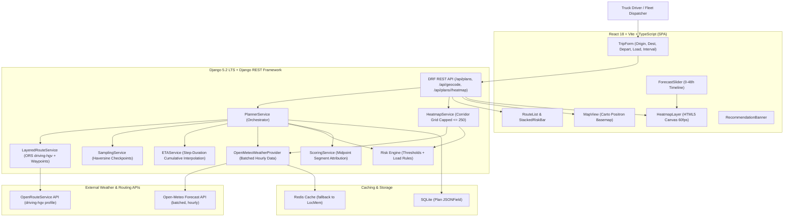

# Weather-Aware Truck Routing

A commercial navigation and risk classification web application that helps truck drivers and fleet dispatchers pick the safest route based on real-time weather forecasts, vehicle load weight, and travel time.

Built for the **Spotter.AI Remote Full Stack Engineer (React + Django, AI Systems)** take-home assessment.

---

## Table of Contents

1. [System Architecture](#system-architecture)
2. [Domain Specification & Risk Logic](#domain-specification--risk-logic)
   - [Risk Levels & Threshold Bands](#risk-levels--threshold-bands)
   - [Vehicle Load Rules](#vehicle-load-rules)
   - [Checkpoint Sampling & Step-Interpolated ETAs](#checkpoint-sampling--step-interpolated-etas)
   - [Midpoint Segment Attribution](#midpoint-segment-attribution)
   - [Lexicographic Recommendation Algorithm](#lexicographic-recommendation-algorithm)
   - [Layered 3-Route Generation & Deduplication](#layered-3-route-generation--deduplication)
   - [48-Hour Corridor Heatmap & 60fps Slider](#48-hour-corridor-heatmap--60fps-slider)
3. [UI & Design System](#ui--design-system)
4. [Quick Start & Running Locally](#quick-start--running-locally)
   - [Option A: Docker Compose (Local Dev)](#option-a-docker-compose-local-dev)
   - [Option B: Single Production Container](#option-b-single-production-container)
   - [Option C: Local Virtualenv + Vite](#option-c-local-virtualenv--vite)
5. [Testing & Verification](#testing--verification)
6. [API Reference](#api-reference)
7. [AI-Assisted Engineering Disclosure](#ai-assisted-engineering-disclosure)
8. [Project Structure & Key Files](#project-structure--key-files)

---

## System Architecture



---

## Domain Specification & Risk Logic

The domain logic represents 40% of the assessment weight. It is implemented purely and tested test-first.

### Risk Levels & Threshold Bands

Risk is evaluated on a strict ordinal scale from `0` (Low) to `4` (No Travel). Values are continuous floats evaluated with **lower bound inclusive, upper bound exclusive**, except where explicitly defined:

| Condition | Low (0) | Moderate (1) | High (2) | Severe (3) | No Travel (4) |
|---|---|---|---|---|---|
| **Sustained Wind (mph)** | `< 25` | `[25, 35)` | `[35, 45)` | `[45, 55)` | `$\ge 55$` |
| **Rain Rate (in/hr)** | `< 0.10` | `[0.10, 0.25)` | `[0.25, 0.50)` | `[0.50, 1.00]` | `> 1.00` |
| **Snow Rate (in/hr)** | `< 0.5` | `[0.5, 1.0)` | `[1.0, 2.0)` | `[2.0, 3.0]` | `> 3.0` |

> **Boundary Semantics Note ([D-008](docs/DECISIONS.md#d-008-weather-threshold-boundary-semantics-and-float-snapping)):** Per the assessment, exactly `1.00 in/hr` rain and `3.0 in/hr` snow classify as **Severe**, while strictly `> 1.00` and `> 3.0` classify as **No Travel**. A float snap tolerance of `1e-7` is applied at boundaries to eliminate floating-point summation noise (`rain + showers`). Sustained 10m wind is used for classification; gusts are informational.

### Vehicle Load Rules

Vehicle load rules only ever **raise** risk, never lower it:
- **Wind $\ge 55\text{ mph}$**, any load: **No Travel**.
- **Wind in $[45, 55)\text{ mph}$** and **load $> 30,000\text{ lb}$**: Escalates from Severe to **No Travel**. (Exactly $30,000\text{ lb}$ does not trigger).
- **Wind in $[35, 45)\text{ mph}$** and **load $> 40,000\text{ lb}$**: Escalates from High to at least **Severe**. (Exactly $40,000\text{ lb}$ does not trigger).

When a load rule triggers, `risk.load_escalated = True` and `"load"` is added to `risk.drivers`, triggering a distinct amber/red warning banner in checkpoint popups.

### Checkpoint Sampling & Step-Interpolated ETAs

1. **Haversine Sampling:** Routes are walked from mile 0, placing checkpoints at user-selected intervals ($10$, $25$, or $50$ miles), and strictly terminating at the destination point.
2. **Step-Duration ETA Interpolation:** Checkpoint arrival ETAs are computed from provider step durations, interpolating linearly within the bounding step by distance. This accurately models real-world conditions (e.g. 70 mph interstate vs. 25 mph city traffic) instead of using a naive single average speed.

### Midpoint Segment Attribution

Each checkpoint covers a slice of the route from the midpoint to the previous checkpoint to the midpoint to the next:
- First checkpoint: $[0.0, \text{midpoint}_1]$
- Intermediate checkpoints: $[\text{midpoint}_{i-1}, \text{midpoint}_i]$
- Final checkpoint: $[\text{midpoint}_{k-1}, \text{total\_distance}]$

This forms a mathematical telescoping sum where segment lengths **strictly sum to the route's total distance** without arbitrary rounding error. Mileage-weighted average risk is calculated as:

$$\text{Avg Risk} = \frac{\sum (\text{segment\_length}_i \times \text{risk\_ordinal}_i)}{\text{total\_distance}}$$

### Lexicographic Recommendation Algorithm

Routes are ranked using strict lexicographic sorting with tie tolerances:

1. **Fewest Severe-or-worse miles** ($\text{Severe} + \text{No Travel}$ miles, per [D-002](docs/DECISIONS.md#d-002-ranking-order-and-the-meaning-of-severe-miles)).
2. **Fewest High miles**.
3. **Lowest average risk**.
4. **Shortest duration**.

Tolerances ($0.01\text{ mi}$, $0.001\text{ risk}$, $1.0\text{s}$) prevent floating-point noise from dropping criteria. A human-readable explanation is generated for the UI. If every route contains No Travel miles, the system returns a prominent **"Do Not Depart"** warning banner.

### Layered 3-Route Generation & Deduplication

To ensure drivers receive **3 distinct alternatives** rather than duplicate paths:
1. Native alternatives from OpenRouteService (`alternative_routes: 3`).
2. Secondary request with alternative routing preferences (`fastest`, `recommended`).
3. Perpendicular detour waypoints at corridor midpoint ($\pm 25\text{ miles}$).
4. **Spatial Deduplication:** Discards any candidate route if $>90\%$ of its sampled points lie within $1.0\text{ km}$ of an already accepted route.

### 48-Hour Corridor Heatmap & 60fps Slider

- **Corridor Grid:** Deduplicated grid points along all route options with $\pm 15\text{ miles}$ perpendicular offsets, capped at 250 points (`MAX_GRID_POINTS = 250`).
- **Batched Forecasting:** 49 hourly intervals ($0\text{ to }48\text{ hours}$ from departure) fetched in batched coordinate calls from Open-Meteo and classified via the risk engine.
- **HTML5 Canvas:** A custom Leaflet `<canvas>` layer renders soft radial gradient discs in the categorical risk palette. Dragging the slider re-draws in $< 5\text{ ms}$ at a fluid 60 fps with **zero network requests** during scrubbing and zero Leaflet layer churn.

---

## UI & Design System

The frontend is styled strictly using Material UI (MUI 9) themed via `createTheme` to match the Section 9 specification and TailAdmin reference:

- **Typography:** `@fontsource/outfit` (weights 400, 500, 600).
- **Primary Brand:** `#465FFF` (brand dark `#3641F5`, brand light `#EBEFFE`).
- **Surface & Borders:** Background `#F8FAFC`, Paper `#FFFFFF`, Borders `#E4E7EC`, Card radius `16px`, Input radius `10px`, Control height `44px`.
- **Categorical Risk Palette:**
  - Low (0): `#12B76A` (Soft `#ECFDF3`)
  - Moderate (1): `#FDB022` (Soft `#FFFAEB`)
  - High (2): `#F97316` (Soft `#FFF4ED`)
  - Severe (3): `#D92D20` (Soft `#FEF3F2`)
  - No Travel (4): `#7A1F1F` (Soft `#F4E6E6`)
- **Map Visual Differentiation:**
  - Recommended: Solid brand blue (`#465FFF`, weight 6.5, foreground).
  - Alternative 1: Solid slate (`#475467`, weight 4).
  - Alternative 2: Dashed sky blue (`#0BA5EC`, weight 4, dash `'8, 8'`).

---

## Quick Start & Running Locally

### Option A: Docker Compose (Local Dev)

Spins up Redis, Django (hot-reloading), and Vite dev server:

```bash
# 1. Copy environment template
cp .env.example .env

# 2. Start services (Docker daemon must be running)
docker compose up --build
```

- **Frontend:** http://localhost:5173
- **Backend API:** http://localhost:8000/api/health

### Option B: Single Production Container

Builds the React frontend and serves it directly through Django using WhiteNoise and Gunicorn as a non-root user:

```bash
docker build -t weather-routing-app .
docker run -p 8000:8000 --env-file .env weather-routing-app
```

- Open http://localhost:8000

### Option C: Local Virtualenv + Vite

Requires Python 3.12 and Node 22+.

```bash
# 1. Backend (Terminal 1)
python -m venv .venv
source .venv/bin/activate       # Windows: .venv\Scripts\activate
pip install -r backend/requirements-dev.txt
cd backend
python manage.py migrate
python manage.py runserver 127.0.0.1:8000

# 2. Frontend (Terminal 2)
cd frontend
npm install
npm run dev
```

- Open http://localhost:5173

---

## Testing & Verification

Every phase was built with automated tests and zero warnings.

```bash
# Backend test suite (172 tests, test-first risk engine, API integration)
cd backend
pytest -v

# Backend code formatting & linting
ruff check .
ruff format --check .

# Frontend unit tests (14 tests, formatters, tokens, popup generator)
cd frontend
npm test

# Frontend TypeScript compilation & ESLint
npm run lint
npm run build
```

---

## API Reference

All error responses use standardized envelopes: `{"error": {"code": "...", "message": "...", "details": {...}}}`.

### `GET /api/health`
Liveness probe and active cache backend indicator (`RedisCache` or `LocMemCache`).

### `GET /api/geocode?q=<text>`
Autocomplete geocoding with 24-hour coordinate caching and major hub fallback resilience.

### `POST /api/plans`
Generate 3 route options, sample checkpoints, compute step-duration ETAs, evaluate weather risk, and rank routes.

**Request:**
```json
{
  "origin": {"label": "Dallas, TX", "lat": 32.7767, "lon": -96.7970},
  "destination": {"label": "Denver, CO", "lat": 39.7392, "lon": -104.9903},
  "depart_at": "2026-11-13T08:00:00-06:00",
  "load_lb": 38000,
  "interval_mi": 25
}
```

### `GET /api/plans/<uuid>`
Retrieve existing persisted plan payload.

### `GET /api/plans/<uuid>/heatmap`
Retrieve 48-hour corridor weather risk heatmap for smooth 60fps canvas rendering.

**Response:**
```json
{
  "plan_id": "908d13b4-f06b-4e1b-b467-336340f1aef4",
  "start_time": "2026-11-13T14:00:00Z",
  "hours": 49,
  "points": [[32.7767, -96.7970], [33.1542, -97.0211]],
  "risk": [[0, 0, 1, 1, 2, ...], [0, 1, 1, 2, 3, ...]]
}
```

---

## AI-Assisted Engineering Disclosure

Per the Spotter.AI job description's bonus evaluation criteria for AI-assisted coding:
- **Tooling:** Developed using Antigravity with Claude 3.5 Sonnet / Gemini models.
- **Workflow:** Strictly phase-by-phase with human-in-the-loop verification gates between phases.
- **Test-First Discipline:** Pure domain services (risk engine, load rules, lexicographic tie-breaking, midpoint coverage) were written and tested before UI integration.
- **Architecture Decisions:** All assumptions, trade-offs, and boundary decisions are documented in [`docs/DECISIONS.md`](docs/DECISIONS.md).

---

## Project Structure & Key Files

```
weather-aware-truck-routing/
├── Dockerfile                           # Multi-stage production container (WhiteNoise + Gunicorn)
├── docker-compose.yml                   # Local dev compose (Redis, Django, Vite)
├── docs/
│   ├── DECISIONS.md                     # Comprehensive log of architectural decisions
│   └── LOOM_SCRIPT.md                   # 7-9 minute Loom walkthrough script
├── backend/
│   ├── config/                          # Django settings, URLs, WhiteNoise config
│   └── planner/
│       ├── models.py                    # Plan model with JSONField
│       ├── views.py                     # DRF REST endpoints
│       ├── serializers.py               # Input validation & boundary checks
│       ├── services/
│           ├── risk.py                  # Pure risk classification & load rules
│           ├── recommend.py             # Lexicographic recommendation engine
│           ├── geometry.py              # Haversine, bearings, RDP simplification
│           ├── sampling.py              # Checkpoint placement & destination snapping
│           ├── eta.py                   # Step-duration cumulative ETA interpolation
│           ├── scoring.py               # Midpoint segment attribution
│           ├── heatmap.py               # Corridor grid generation & 48h evaluation
│           ├── routing/                 # ORS driving-hgv provider & route set deduplication
│           └── weather/                 # Open-Meteo batched client & interpolation
│       └── tests/                       # 172 pytest unit and integration tests
└── frontend/
    ├── src/
    │   ├── theme.ts                     # Outfit MUI theme & TailAdmin token palette
    │   ├── api/client.ts                # Typed API client
    │   ├── hooks/usePlan.ts             # TanStack Query hooks
    │   ├── types/                       # Strict domain and API interfaces
    │   ├── utils/formatters.ts          # Duration, distance, and ETA formatters
    │   └── components/
    │       ├── TripForm.tsx             # Origin/Dest autocomplete & time picker
    │       ├── RiskChip.tsx             # Risk badge pills with matched icons
    │       ├── routes/                  # RouteList, RouteCard, StackedRiskBar, RecBanner
    │       └── map/                     # MapView, HeatmapLayer, ForecastSlider, RouteLayers
    └── package.json
```
